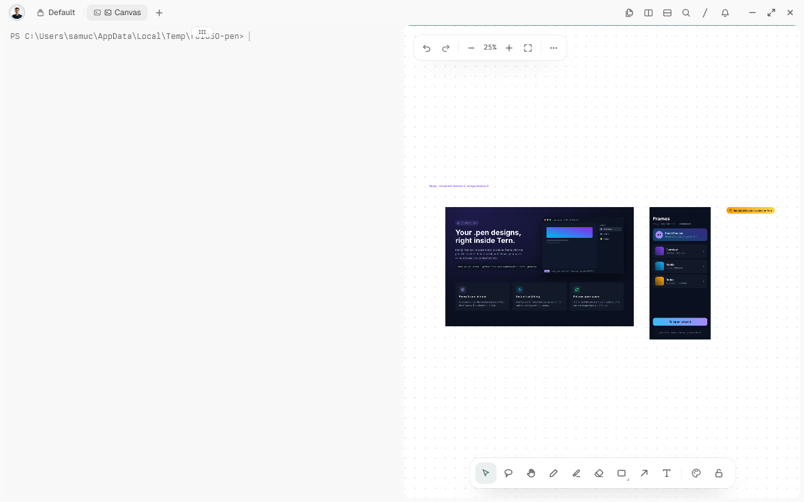

# tern-pencil-preview

Pencil Editor brings pen.dev (Pencil) `.pen` designs into Tern as a native editor: a dedicated headless Pen engine
per document and a whiteboard that shows every top-level frame as an image, placed like the Pencil canvas. You edit
on the board itself: moving, resizing, reordering and double-clicking text apply to the document's own history as you
go. Edits made through the Pencil MCP apply to the same history.



The example design is [`tests/fixtures/sample.pen`](tests/fixtures/sample.pen).

A separate, explicit **"Open Pencil board (live mirror)"** command still opens a read-only whiteboard mirror of any
`.pen` file, independent of the editor.

## Requirements

- Tern with plugin support (tested on Tern 0.9.5).
- Node.js 22 or later, on `PATH` or found by Tern.
- The pen.dev CLI (`npm install -g @pen.dev/cli`; the pen.dev CLI requires Node 22.19 or later), signed in with
  `pen login`. Exports require an authenticated CLI.

Verified on Windows. On macOS and Linux the plugin runs `pen` and `node` from `PATH`; this is not verified yet.

## Install

```
tern plugin install github.com/SamuelFontess/tern-pencil-preview
```

To update an installed copy (also from 0.4.x), run the same command with `--force`; without it Tern refuses because
the plugin is already installed. The plugin's data is kept.

```
tern plugin install --force github.com/SamuelFontess/tern-pencil-preview
```

For development, link a checkout instead:

```
tern plugin link <dir>
```

## Usage

- Open a `.pen` file from the Files pane or the palette (a plain open; an open with a placement goes to Tern's own
  editor instead).
- The command **"Open Pencil editor"** prompts for a path directly.

On Tern 0.9.5, `tern open design.pen` typed in a terminal does not reach the plugin: Tern answers "cannot open in a
file block". Use the Files pane, the palette or "Open Pencil editor" instead.

The command "Toggle Pencil Preview for .pen opens" switches the routing. When it is off, `.pen` opens go to Tern's
own editor instead; "Open Pencil editor" and "Open Pencil board (live mirror)" still work. The setting is shared by
all windows.

### The editor

Opening a `.pen` file starts its own Pen engine and opens only the whiteboard, beside the pane you are in; no new tab
appears. The engine's program runs as a background process that the plugin starts with `tern.process.run`: it has no
pane, and on Windows no console window opens. A line of activity at the top
of the board is the status: the document's phase and revision, whether the render matches it, and whether there are
unsaved edits.

Editing on the board:

- **Select**: click an element on the board; the same element becomes the document's selection. A click picks the
  outer element: at rest each frame offers only its direct children, so pressing in the middle of a block picks the
  block, not the text inside it. The targets are drawn almost transparent (they are there to be clicked, not seen), and
  the selected one shows only the board's own selection box.
- **Go inside**: double-click a container (an element that has children) to go into it; the board then offers its
  children, and only those, in that frame. A click outside the container goes back one level, and so does Esc once
  something in the container is selected (Esc deselects it). Right after going in, or after an edit (the board is
  redrawn and nothing is selected), Esc has nothing to deselect and the board gives the plugin no sign of it, so use a
  click outside the container. The activity line says you are inside a container, and the level stays through the
  redraws that follow your edits. Double-clicking a text still edits the text.
- **Move or resize**: drag or resize a target. When the gesture has paused for two polls in a row, it is applied to
  the document as one history step, with no Apply button. Moving a target back to where it was is applied like any
  other move, because the board redraws from the document after each apply. A free element (its parent has no auto-layout) takes `x`/`y`; a resize applies to each axis that has a fixed
  size.
- **Automatic or inherited values come back**: an element whose position comes from an auto-layout parent, whose size
  is automatic (fit, fill or a variable), or that is hidden, clipped, rotated or scaled, jumps back to where the
  document puts it, with a notice saying why. The same happens when the engine refuses the change.
- **Reorder**: dropping an auto-layout child with its centre inside its parent, in a different place among its
  siblings along the layout's axis, moves it to that position in the same parent. Dropped outside the parent, or in
  the same place, it goes back with a notice. A frame with no `layout` is horizontal, as in the engine. A child whose
  `layoutPosition` is `absolute` is not part of the layout: it moves freely and is never reordered.
- **Text**: double-click a text element to edit its text on the board. When the board's editor opens with the whole
  text selected, typing replaces all of it; to change only part, click inside the text or use the arrow keys to place
  the caret first. The change is applied when you select
  something else (or click away), or when the text has stayed as you typed it for 1.5 s. Escape discards the edit: the
  label and the document stay as they were. Ctrl+Enter commits the label without deselecting; a click on blank commits
  and deselects. Text bound to a variable, inside a component instance, or longer than 1000 characters is not
  editable on the board. If an agent changes the same text meanwhile, you choose on the
  board between keeping the document's text and yours; nothing is overwritten silently. Enter inserts a line break
  (it does not finish the edit): to finish, click outside the text. A line break left at the end of the text is
  dropped when it is applied; breaks inside the text stay.

The board's own Ctrl+Z undoes only drawing on the board (the plugin removes any target that comes back); it is not
the document's undo. Use the palette commands below for that.

Commands in the palette:

- **Pencil: Save**, **Pencil: Undo**, **Pencil: Redo**: act on the editor whose board is focused (or the only open
  editor). Undo and redo move the document's own history, and the board follows. Save writes the original `.pen`;
  if it changed on disk meanwhile the save is refused and closing the board offers a recovery copy.
- **Pencil: Copy MCP configuration**: copies the MCP client configuration for the focused (or only) editor.
- **Reopen Pencil editor board**: brings the board back for a session that is still running without one (for
  example when the board could not be opened).

Closing the board closes the editor. With nothing unsaved the editor just ends; with unsaved confirmed edits the
board asks **Save / Discard / Back**. Back (or dismissing the question) reopens the board in the same session;
Discard never writes the original. The images and annotations you added to the board stay (read-only); the
editor's interactive targets are removed. A save refused because the file changed on disk meanwhile offers
**Save a recovery copy / Discard / Back** on the board.

How the editor ends. The window asks the program to end with a request of its own (`close_editor`, which only the
window that holds the editor's token can make); the program then closes its document, releases the file's lock,
removes its working copy and its session record, and stops its engine. Every close (nothing unsaved, Discard, Save,
a recovery you chose, a blocked document) is that same request, made after the choice it follows. Unsaved edits
that were not discarded stay in the editor's history; they are not written to your `.pen` file.

If the window goes away without asking (Tern was closed, the window crashed, the machine slept through a reload), the
program does not stay for ever. Tern does not stop a process it started when it closes (checked: it kept running after
Tern quit), so this is what ends it: when no window has asked it for anything for **2 minutes** it ends the same way
(unsaved edits stay in its history, the file is never written). Two minutes is longer than a plugin reload (seconds),
a window waiting for another one's lease (10 s) or a Tern that is closed and opened again, and short enough that a file
is not left locked. A machine that was suspended does not count against it. What this means for you:

- Open the same file again within those 2 minutes, in this window or after reopening Tern, and the window **reconnects**
  to the program that is still running instead of failing with "already open".
- After they have passed, or after a crash, opening the file again offers once to **restore your edits**, **use the
  file on disk**, or save a copy.
- An agent's MCP calls do not keep an editor alive: only the window does.
- A window that is open keeps its editor for as long as it is open: while the question "Save / Discard / Back" waits,
  or a board could not be opened, the window asks every few seconds. A window that reconnected to another window's
  editor does nothing to it until it holds the lease.

If the editor's program dies while Tern is open you get one notice (and, when it died while starting, the reason it
left: the file is open in another editor, it changed while opening, the engine did not start, Node is missing).

Several windows: one window at a time drives an editor. A second window that asks for the same document is told that
another window is showing it, until the first has been silent for 10 s. Reloading plugins with an editor open
resumes the session: the program keeps running (Tern only drops its callback), the window finds it again by its session
record, the board keeps updating and nothing is started twice.

Agents: an MCP client works on the same open document through the editor's local endpoint. Focus the board (or have
only one editor open) and run **Pencil: Copy MCP configuration** from the palette: it puts an `mcpServers` entry
(`pencil-editor`, running `node` on the plugin's `runtime/mcp.mjs`, with `--document` and `--data-dir` for that document) on the
clipboard, ready to paste into your MCP client's configuration; nothing in your settings is changed. An invalid change
(the engine refuses it) comes back as `OPERATIONS_REJECTED` with the engine's reason and leaves the session and the
document as they were.

Activity (a purple highlight while rendering, a notice on export failure) belongs to the document, not to the
focused pane or to whichever agent is editing it: a change made through MCP in one window's board does not mark a
second window's board of the same document as busy, only as needing a refresh once the render catches up.

### Board (live mirror)

The command "Open Pencil board (live mirror)" asks for the path of a `.pen` file (the last one is filled in) and
opens a Tern whiteboard beside the focused block with every top-level frame as an image, placed like the Pencil
canvas. It shows the file's unsaved edits from the Pencil app, so a change made in Pencil or by an agent (for
example through the Pencil MCP) appears on the board a few seconds after Pencil writes its backup; with no unsaved
edits it shows the file. For a 17-frame file, a single changed frame takes about 5 s from the backup to the
board.

The board is a mirror: nothing you draw or move on it reaches Pencil or the file. The frame images are locked.
Running the command again closes the board this plugin opened before; a board left over from before a plugin
reload stays open until you close it. This command is independent of the editor above: it never substitutes for a
failed editor open, and the editor never falls back to it.

Run the command from the Tern palette, or from a terminal inside Tern:

```sh
tern ctl plugins run plugin.pencil-preview.board
```

Enter the full path of your `.pen` file. To try the example in this repository, use the full path to
`tests/fixtures/sample.pen` in your checkout.


### How the board renders

When the file changes and then holds still for one poll (2 s), the board runs `pen interactive` headless once: for
every top-level frame, it hashes the frame's content inside pen and exports it as PNG at scale 1 only when the hash
differs from the one the board was drawn from. Editing a variable, a reusable component or a top-level node that is
not a frame exports every frame. The board then replaces just the images that were exported, in one whiteboard
call. While Pencil has unsaved edits of the file, it keeps a backup of the whole document in `~/.pencil/backup/`
(rewritten about every 5 s and deleted on save or discard); the board reads that backup instead of the file. The
`.pen` file and the backup are never written by the board.

## Configuration

`TERN_PENCIL_CLI`: path to `pen`, `pen.cmd`, `pen.exe` or the CLI's `index.mjs`. Needed when Tern was started
without the npm global bin directory on `PATH`.

## Upgrading from 0.4.x

```
tern plugin install --force github.com/SamuelFontess/tern-pencil-preview
```

0.5.0 removes the static "Pencil Preview" block (frames-as-images, layers and an inspector, with no editing): the
editor above replaces it, with the same read access plus editing. A pane of the old block, open during the update or
restored from a workspace saved under 0.4.x, shows a short notice instead of an error: the preview was replaced by the
editor, with the name of the file it had and how to open it ("Open Pencil editor" in the command palette, or open the
`.pen` from the Files pane). The notice reads nothing and starts nothing; close the pane. The plugin's data and
everything under `~/.pencil`, and your `.pen` files, stay as they were.

## Limitations

- Do not open a `.pen` that lives inside the folder of a plugin you linked with `tern plugin link`: the editor writes
  its working copy next to the original, and Tern reloads every plugin when a file changes in a linked folder. Keep
  designs outside it.
- You cannot create or delete nodes on the board. Reordering stays within the same parent; dragging a child into
  another parent is not supported.
- A slow drag can bounce back before you release it: the board takes a pause in the drag for its end. Drag in one
  motion (a fix is planned for 0.5.1).
- Esc goes up a level only when an element is selected; right after going into a container, or after an edit,
  nothing is. A click outside the container always works.
- On a machine that is overloaded, Tern can switch off the plugin's timers (a callback ran over its 50 ms budget).
  The plugin says so and carries on without them: an open that was in progress continues by itself (also one cut while
  the editor's modules were still loading, the first time after an update) and an editor that
  was open keeps going, but run **Reload plugins** from the command palette to restore the timers. Nothing is
  reloaded automatically. The read-only live mirror cannot follow its file without the timers: if they are stopped
  when its command loads (or stop while it does), the plugin says so (reload plugins) instead of carrying on. If Tern
  switches off the plugin's `await` hook too (seen once, during a plugin reload with an editor open on a machine at
  97% CPU), nothing can carry on until **Reload plugins**.
- On Tern 0.9.5, `tern open design.pen` does not reach the plugin (see Usage).
- The first use of a web font needs the network.
- The board (live mirror) is verified on Windows only, with Pencil 1.2.15. Frames are drawn at scale 1, so text
  softens when you zoom in beyond 100%. It relies on Pencil's internal backup file; if Pencil changes it, the
  board shows the saved file instead. It is not restored when Tern restarts.
- The editor's own top-level frame rendering is scale 1 as well; very large designs render at the same cost as the
  board mirror.
- `.pen` files over 16 MiB are refused by the board mirror's host-side read; the editor has no such limit of its
  own but is bounded by the engine's own request and history limits (documented in the editor's `get_document`
  reply).

## Development

```
python scripts/gate.py
```

`--engine` also runs the real-engine integration tests (`editor/integration/*.test.mjs`); set `TERN_PENCIL_CLI` to
the Pen CLI's `index.mjs` or executable first (not the Windows `.cmd` wrapper), and build the runtime bundles
(`npm run build`) before running it. The gate type-checks every non-test `.luau` file with `luau-lsp`, runs
`luau tests/run.luau`, the Node unit tests and the build check; `LUAU_TOOLS` sets the Luau tools' folder.

```sh
npm ci --ignore-scripts
npm test
npm run build
npm run check:build
npm run test:engine
node editor/smoke/owner.mjs
```

The owner smoke starts the packaged `runtime/editor.mjs` the way Tern starts it (a plain process, stdin closed, no
terminal) and follows a document through edit, Save, close, recovery and discard; it never touches Tern or your data.

Layout:

- `plugin.toml`, `window.luau` (open routing, the toggle command, the editor and board commands, the palette's Save /
  Undo / Redo / Copy MCP configuration, each loading its own module chain one tick at a time so the window `load` hook stays under its 50 ms
  budget).
- `board.luau`: the read-only whiteboard mirror and its poll loop.
- `editor_board.luau`: the editor's window-side entry (`run`, `open`, `reopen`, `adopt` and the palette actions), over the owner process started
  from `editor/src/` (`runtime/editor.mjs`, `runtime/mcp.mjs`). Its work is split by responsibility into modules of a few
  hundred lines each, so that each one compiles inside its own 50 ms tick: `editor_core.luau` (state, status file,
  registry), `editor_lifecycle.luau` (ticks and calls to the owner, retiring a session), `editor_closing.luau` (closing,
  recovery, reopening the board), `editor_build.luau` (drawing the frames and click targets), `editor_capture.luau`
  (clicks and gestures on the board), `editor_text.luau` (text typed on a target), `editor_palette.luau` (Save, Undo,
  Redo and Copy MCP configuration), `editor_loop.luau` (the session's step), `editor_start.luau` (launching) and `editor_adopt.luau` (what a plugin
  reload leaves behind).
- `lib/`: `doc.luau` and `script.luau` (the `pen interactive` snippets and their parsed summary, shared by the
  board and, through `util.luau`, the editor), `launch.luau` (finds the pen CLI and the OS opener), `cache.luau` /
  `canon.luau` (render cache keys and cleanup rules), `util.luau` (paths, image sizes and frame/layer helpers),
  `mirror.luau` (the board's export-and-redraw snippet), `editor_launch.luau` (the editor's own launch manifest),
  `editor_projection.luau` (the whiteboard projection; it only gathers `editor_projection_session.luau`, `_batch.luau`,
  `_targets.luau` and `_messages.luau`, each loaded in its own tick), `editor_gesture.luau` / `editor_draft.luau`
  (reading a drag or resize off the board into candidate changes), `editor_label.luau` (text typed on a target),
  `editor_close.luau` (closing, recovery and conflict choices), `editor_palette.luau` (which session a palette command
  acts on, and the `mcpServers` text that Copy MCP configuration copies), `editor_registry.luau` (sessions kept in `tern.kv` across a plugin reload), `editor_hooks.luau` (tells when
  Tern disabled the plugin's timers), `sha1.luau`, `editor_chain.luau` (the editor's load chain: one module per tick,
  a tick Tern killed run once more on either hook, the rest of the chain moved to the await hook once the timer hook is
  gone) and `editor_load.luau` (what `window.luau` runs it with, and the notices to the user).
- `editor/src/`: the owner process (document session, history, save, MCP server, renderer, the board's geometry in
  `geometry.mjs`, `layout.mjs` and `reorder.mjs`, the document model the board follows in `panel-model.mjs`, and
  `orphan.mjs`, which ends an owner no window asks for) built to `runtime/editor.mjs` and
  `runtime/mcp.mjs` by `editor/build.mjs`.
- `tests/`: `*_test.luau` unit tests registered in `run.luau`, the `tern` stub in `stub.luau`, and `fixtures/`.
  `editor/tests/`, `editor/integration/`: Node unit and real-engine tests for `editor/src/`.

## License

MIT. See [LICENSE](LICENSE).
