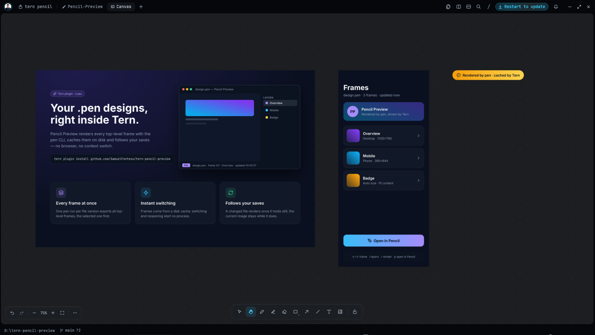
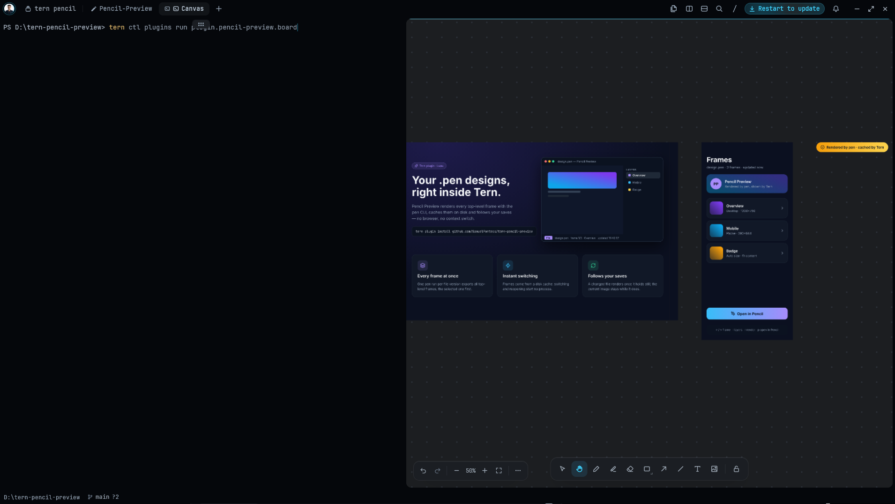

# tern-pencil-preview

Pencil Preview 0.4.0 brings pen.dev (Pencil) `.pen` designs into a live Tern whiteboard: every top-level frame appears as an image, arranged like the Pencil canvas. The board mirrors unsaved changes made in Pencil or through the Pencil MCP, updating only the frames that changed.

**The board is read-only:** editing, moving or drawing on it does not change Pencil or the `.pen` file. Editing designs from Tern is not supported yet.



The example design is [`tests/fixtures/sample.pen`](tests/fixtures/sample.pen).

The native preview block is also available for browsing individual frames, layers and properties.

## Requirements

- Tern with plugin support (built against 0.8.3).
- The pen.dev CLI (`npm install -g @pen.dev/cli`; the pen.dev CLI requires Node 22.19 or later), signed in with `pen login`. Exports require an authenticated CLI.

Verified on Windows. On macOS and Linux the plugin runs `pen` from `PATH`; this is not verified yet.

## Install

```
tern plugin install github.com/SamuelFontess/tern-pencil-preview
```

For development, link a checkout instead:

```
tern plugin link <dir>
```

## Usage

- `tern open design.pen` (any placement).
- Open a `.pen` file from the Files pane or the palette.
- "Open with › Pencil Preview" on a file.

The command "Toggle Pencil Preview for .pen opens" switches the routing. When it is off, the Files pane, the palette and `tern open` use the editor; "Open with" still works. The setting is shared by all windows.

Routing details: from the Files pane and the palette only a plain open is routed to the preview (an open with a placement goes to the editor); `tern open` is routed with any placement. Any open that asks for a line goes to the editor.

### Keys

| Key | Action |
| --- | --- |
| `Left` / `[` | Previous frame |
| `Right` / `]` | Next frame |
| `l` | Show or hide the layers and inspector panel |
| `Up` / `k` | Previous layer (panel open) |
| `Down` / `j` | Next layer (panel open) |
| `y` | Copy the selected layer id |
| `r` | Render again (queued if a render is running) |
| `Space` | Pause or resume watching the file |
| `v` | Show or hide unsaved edits from the Pencil app (on by default) |
| `p` | Open the file in the system app |
| `o` | Open the file in the editor |

Keys with Ctrl, Alt or Meta are not handled by the block. Clicking a layer in the list selects it. The chosen frame, selected layer, panel and pause state are restored when the block restarts.

### Board (live mirror)

The command "Open Pencil board (live mirror)" asks for the path of a `.pen` file (the last one is filled in) and opens a Tern whiteboard beside the focused block with every top-level frame as an image, placed like the Pencil canvas. It shows the file's unsaved edits from the Pencil app, so a change made in Pencil or by an agent (for example through the Pencil MCP) appears on the board a few seconds after Pencil writes its backup; with no unsaved edits it shows the file. For a 17-frame file, a single changed frame takes about 5 s from the backup to the board.

The board is a mirror: nothing you draw or move on it reaches Pencil or the file. The frame images are locked. Running the command again closes the board this plugin opened before; a board left over from before a plugin reload stays open until you close it.

Run the command from the Tern palette, or from a terminal inside Tern:

```sh
tern ctl plugins run plugin.pencil-preview.board
```

Enter the full path of your `.pen` file. To try the example in this repository, use the full path to `tests/fixtures/sample.pen` in your checkout.



## How it works

When the file changes and then holds still for one poll (2 s), the block runs `pen interactive` headless once: it exports every top-level frame that has no cached image yet (the selected one first) as JPEG, or PNG for a frame without a background, at a scale up to 2 that keeps each image within 4096 px a side, then reads the layers. The images go to a render cache in the plugin data folder, so switching frames and reopening the file need no new run. The cache keeps the 2 latest versions of each file and at most 200 MB in all. The `.pen` file is never written. When the block cannot read the file's frames itself, it falls back to rendering one frame per run. Top-level frames without a fixed size, and frames the batch could not fit within 4096 px, are rendered one per run when selected, into the same cache; an unchanged frame without a fixed size reuses its image in later versions and on reopen.

While Pencil has unsaved edits of the file, it keeps a backup of the whole document in ~/.pencil/backup/ (rewritten about every 5 s and deleted on save or discard). The block reads that backup instead of the file, renders a copy of it with relative image paths resolved next to the file, and shows Live · unsaved in the dock. Each top-level frame has a key (a hash of the frame and of the document's variables, components and other top-level nodes); a new version exports only frames whose key has no image yet.

The board uses the same sources. Every 2 s it reads the backup (or the file) and compares the text with the last version; on a change it copies the backup next to its own data, runs `pen interactive` once and, for every top-level frame, hashes the frame's content inside pen and exports it as PNG at scale 1 only when the hash differs from the one the board was drawn from. Editing a variable, a reusable component or a top-level node that is not a frame exports every frame. The board then replaces just the images that were exported, in one whiteboard call. The `.pen` file and the backup are never written.

## Configuration

`TERN_PENCIL_CLI`: path to `pen`, `pen.cmd`, `pen.exe` or the CLI's `index.mjs`. Needed when Tern was started without the npm global bin directory on `PATH`.

## Errors

- With no image yet, a failure shows as a card with the tail of the CLI output and Render / Open in Pencil buttons; the card shows "Rendering …" while a render runs. With an image already shown, the image stays and a notice appears in the dock; an error toast also appears when the notice first appears.
- A failed render is not retried until the file or the frame changes, or you press `r`. Pressing `r` while a render runs queues another render, also while paused.
- A batch that takes longer than 120 s (60 s for a single frame) is tried again when the file changes or when you press `r`.
- The render-failure card suggests running `pen login`.
- The missing-CLI card names `TERN_PENCIL_CLI`.

## Limitations

- Live mode relies on Pencil's internal backup file (tested with Pencil 1.2.15 on Windows); if Pencil changes it, the block shows the saved file.
- Top-level frames only.
- The layer tree is read to depth 6.
- `.pen` files over 16 MiB are refused.
- No editing.
- The board is verified on Windows only, with Pencil 1.2.15. Frames are drawn at scale 1, so text softens when you zoom in beyond 100%.
- The board is not restored when Tern restarts, and it does not show that an agent is editing.

## Development

```
python scripts/gate.py
```

The gate type-checks every non-test `.luau` file with `luau-lsp` and runs `luau tests/run.luau`. It needs `luau` and `luau-lsp`; `LUAU_TOOLS` sets their folder.

Layout:

- `plugin.toml`, `host.luau` (the `preview` block), `window.luau` (open routing, the toggle command and the board command, which loads `board.luau` and its `lib/` chain one tick at a time so the window `load` hook stays under its 50 ms budget), `board.luau` (opening the board and its poll loop).
- `lib/`: `doc.luau` (reads the `.pen` top-level frames and parses the render summary), `launch.luau` (finds the pen CLI and the OS opener), `script.luau` (builds the snippets sent to `pen interactive`), `cache.luau` (render cache keys and cleanup rules), `store.luau` (render cache on disk), `util.luau` (paths, image sizes and frame/layer helpers), `view.luau` (block view).
- `lib/mirror.luau`: the pen snippet that exports only changed frames, how its answer is read and the whiteboard edits that follow. `cache.shared_seed` is the hash of what all frames share.
- `tests/`: `*_test.luau` unit tests registered in `run.luau`, the `tern` stub in `stub.luau`, and `fixtures/`.

## License

MIT. See [LICENSE](LICENSE).
