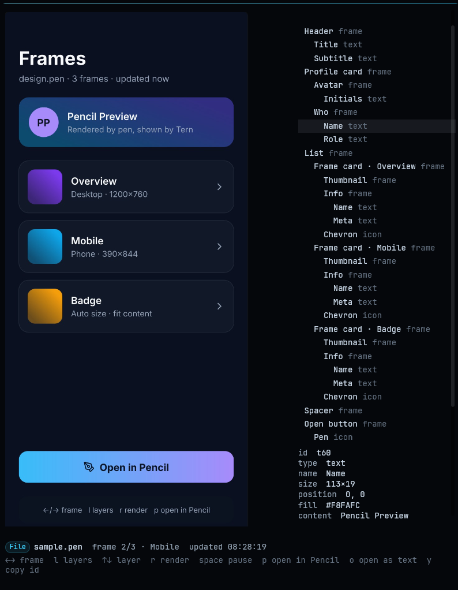
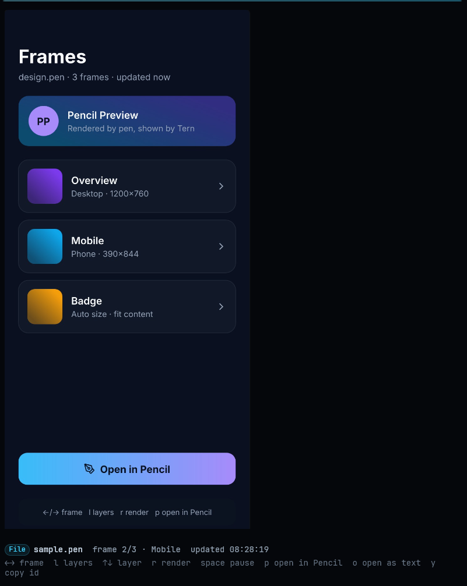

# tern-pencil-preview

Previews pen.dev (Pencil) `.pen` designs in a native Tern block: the selected top-level frame (switch with Left/Right) as an image, its layers and an inspector, re-rendered when the file changes, and unsaved edits while the file is open in the Pencil app.





The example design is [`tests/fixtures/sample.pen`](tests/fixtures/sample.pen).

## Requirements

- Tern with plugin support (built against 0.8.3).
- The pen.dev CLI (`npm install -g @pen.dev/cli`; the pen.dev CLI requires Node 22.19 or later), signed in with `pen login`. Exports require an authenticated CLI.

Verified on Windows. On macOS and Linux the plugin runs `pen` from `PATH`; this is not verified yet.

## Install

```
tern plugin install github.com/SamuelFontess/tern-pencil-preview
```

For development, link a checkout instead:

```
tern plugin link <dir>
```

## Usage

- `tern open design.pen` (any placement).
- Open a `.pen` file from the Files pane or the palette.
- "Open with › Pencil Preview" on a file.

The command "Toggle Pencil Preview for .pen opens" switches the routing. When it is off, the Files pane, the palette and `tern open` use the editor; "Open with" still works. The setting is shared by all windows.

Routing details: from the Files pane and the palette only a plain open is routed to the preview (an open with a placement goes to the editor); `tern open` is routed with any placement. Any open that asks for a line goes to the editor.

### Keys

| Key | Action |
| --- | --- |
| `Left` / `[` | Previous frame |
| `Right` / `]` | Next frame |
| `l` | Show or hide the layers and inspector panel |
| `Up` / `k` | Previous layer (panel open) |
| `Down` / `j` | Next layer (panel open) |
| `y` | Copy the selected layer id |
| `r` | Render again (queued if a render is running) |
| `Space` | Pause or resume watching the file |
| `v` | Show or hide unsaved edits from the Pencil app (on by default) |
| `p` | Open the file in the system app |
| `o` | Open the file in the editor |

Keys with Ctrl, Alt or Meta are not handled by the block. Clicking a layer in the list selects it. The chosen frame, selected layer, panel and pause state are restored when the block restarts.

## How it works

When the file changes and then holds still for one poll (2 s), the block runs `pen interactive` headless once: it exports every top-level frame that has no cached image yet (the selected one first) as JPEG, or PNG for a frame without a background, at a scale up to 2 that keeps each image within 4096 px a side, then reads the layers. The images go to a render cache in the plugin data folder, so switching frames and reopening the file need no new run. The cache keeps the 2 latest versions of each file and at most 200 MB in all. The `.pen` file is never written. When the block cannot read the file's frames itself, it falls back to rendering one frame per run. Top-level frames without a fixed size, and frames the batch could not fit within 4096 px, are rendered one per run when selected, into the same cache.

While Pencil has unsaved edits of the file, it keeps a backup of the whole document in ~/.pencil/backup/ (rewritten about every 5 s and deleted on save or discard). The block reads that backup instead of the file, renders a copy of it with relative image paths resolved next to the file, and shows Live · unsaved in the dock. Each top-level frame has a key (a hash of the frame and of the document's variables, components and other top-level nodes); a new version exports only frames whose key has no image yet.

## Configuration

`TERN_PENCIL_CLI`: path to `pen`, `pen.cmd`, `pen.exe` or the CLI's `index.mjs`. Needed when Tern was started without the npm global bin directory on `PATH`.

## Errors

- With no image yet, a failure shows as a card with the tail of the CLI output and Render / Open in Pencil buttons; the card shows "Rendering …" while a render runs. With an image already shown, the image stays and a notice appears in the dock; an error toast also appears when the notice first appears.
- A failed render is not retried until the file or the frame changes, or you press `r`. Pressing `r` while a render runs queues another render, also while paused.
- A batch that takes longer than 120 s (60 s for a single frame) is tried again when the file changes or when you press `r`.
- The render-failure card suggests running `pen login`.
- The missing-CLI card names `TERN_PENCIL_CLI`.

## Limitations

- Live mode relies on Pencil's internal backup file (tested with Pencil 1.2.15 on Windows); if Pencil changes it, the block shows the saved file.
- Top-level frames only.
- The layer tree is read to depth 6.
- `.pen` files over 16 MiB are refused.
- No editing.

## Development

```
python scripts/gate.py
```

The gate type-checks every non-test `.luau` file with `luau-lsp` and runs `luau tests/run.luau`. It needs `luau` and `luau-lsp`; `LUAU_TOOLS` sets their folder.

Layout:

- `plugin.toml`, `host.luau` (the `preview` block), `window.luau` (open routing and the toggle command).
- `lib/`: `doc.luau` (reads the `.pen` top-level frames and parses the render summary), `launch.luau` (finds the pen CLI and the OS opener), `script.luau` (builds the snippets sent to `pen interactive`), `cache.luau` (render cache keys and cleanup rules), `store.luau` (render cache on disk), `util.luau` (paths, image sizes and frame/layer helpers), `view.luau` (block view).
- `tests/`: `*_test.luau` unit tests registered in `run.luau`, the `tern` stub in `stub.luau`, and `fixtures/`.

## License

MIT. See [LICENSE](LICENSE).
