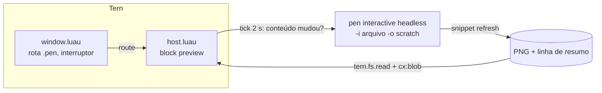

# tern-pencil-preview — Design

Data: 2026-10-13 · Status: incremento 1 aprovado para implementação

## Objetivo

Plugin do Tern que mostra designs `.pen` (pen.dev / Pencil) num block nativo:
imagem de cada frame de topo, layers e inspetor, atualizando quando o design
muda. O Pencil continua sendo o editor; o Tern é a janela de revisão. Entrega
em incrementos, cada um só sobre contratos documentados do pen CLI.

## Fatos verificados (2026-10-13, Windows, pen CLI 0.3.9, Tern 0.8.3)

| Fato | Evidência |
| --- | --- |
| `pen interactive -i f.pen -o tmp.pen` (headless, documentado) aceita comandos por stdin e sai com `exit()`; sem `save()` não grava nada | `Get`, `Export` executados, exit 0, arquivos intactos |
| Headless leva ~3 s por execução | medido |
| `Export(ids, "png", dir, {scale})` grava `<dir>/<nodeId>.png`; escala padrão 2 | frame 400×300 → 800×600 |
| Formatos de export: png, jpeg, webp, pdf, html-tailwind, html-css. **Sem SVG** | erro do `Export` com `"svg"` |
| `Get(visit)` dá `ctx.bounds` com tamanho resolvido, inclusive frames `fit_content` | frame sem `width`/`height` → 60×67 |
| No headless, `Print(string)` sai cru numa linha do stdout | saída real |
| `pen interactive -a desktop` (documentado, "changes are applied live") conecta no app em ~1,7 s; a saída de cada comando vem num objeto JSON `{"message": "…"}` | saída real |
| No modo app, **`-i` não escolhe o documento**: comandos agem no documento ativo do app | `-i sample.pen` devolveu o conteúdo de `probe.pen` |
| Edição feita por agente no app fica na memória; **não chega ao disco** sem o usuário salvar | `Update` + 10 s observando o arquivo |
| O export pelo app reflete o estado não salvo | PNG mudou após `Update` |
| No Windows `pen` é `pen.cmd`, que roda `node <npm>/node_modules/@pen.dev/cli/dist/index.mjs %*` | conteúdo do shim |
| `tern.process.run` executa sem shell e procura o programa no `PATH` do daemon | doc da API |
| Node `image` do Tern: PNG/JPEG/WebP/GIF até 4096 px por lado, blob via `cx:blob`; só em block/lens | doc de elementos |

## Incrementos

### Incremento 1 — preview a partir do arquivo (esta entrega)

1. Block `pencil-preview.preview` que abre um `.pen` e mostra:
   - seletor de frames de topo (anterior/próximo);
   - imagem PNG do frame selecionado, ajustada ao painel, com o zoom nativo do Tern;
   - painel de layers do frame (lista indentada, selecionável) e inspetor do layer selecionado;
   - dock: nome do arquivo, frame i/n, hora da última renderização, aviso e atalhos.
2. Fonte: o arquivo no disco, renderizado pelo `pen interactive` headless.
3. Atualização automática: confere o arquivo a cada 2 s e renderiza de novo quando o conteúdo muda; pausa e retomada.
4. Formas de abrir: "Open with › Pencil Preview"; abrir `.pen` pelo Files, pela paleta ou com `tern open` (rota com interruptor).
5. Ações: abrir no app padrão do sistema para `.pen` (o Pencil), abrir o `.pen` como texto, copiar o id do layer, renderizar de novo.

### Incremento 2 — modo ao vivo (próxima entrega)

Quando o arquivo está aberto e ativo no Pencil, renderizar pelo `pen interactive -a desktop`, para ver alterações ainda não salvas (as do agente, por exemplo). Proteção obrigatória: na mesma sessão, `get_app_state()` antes e depois do snippet; o resultado só vale se as duas respostas apontarem o documento ativo para o nosso arquivo. Caso contrário, fica no modo arquivo. Dock mostra "Live" ou "File".

### Incremento 3 — edição leve (depois do 2)

Só no modo ao vivo: `e` muda o `content` de um layer `text` e `f` muda o `fill` sólido (`#RRGGBB` ou `#RRGGBBAA`) com `Update(id, {...})`. A alteração entra no undo do Pencil e o usuário salva lá. No modo arquivo, editar fica desligado, para o plugin nunca regravar o arquivo do usuário.

### Fora de escopo

Reconstruir o canvas em componentes nativos; editar geometria/layout; criar nodes; diff visual entre versões; uso do binário MCP interno do app; validação em macOS/Linux nesta entrega (README marca como não verificado).

## Arquitetura (incremento 1)



Tudo roda na metade **host** (worker do daemon, 2 s por chamada); processos sempre por `tern.process.run` com callback e `timeout_ms`. A metade **window** só roteia aberturas e registra o comando do interruptor.

### Arquivos

| Arquivo | Responsabilidade |
| --- | --- |
| `plugin.toml` | id `pencil-preview`, nome "Pencil Preview", ícone `pen`, block `preview` (`files = ["*.pen"]`, `palette = false`) |
| `host.luau` | `tern.block.define("preview", …)`: estado, ciclo, teclas, eventos, save/restore |
| `window.luau` | `tern.route.open` para `.pen` e comando do interruptor |
| `lib/launch.luau` | argv do pen CLI e do abridor do sistema, com override por variável de ambiente |
| `lib/script.luau` | Snippet JS `refresh` e o stdin de uma sessão `pen interactive` |
| `lib/doc.luau` | Acha e interpreta a linha de resumo → frames e layers |
| `lib/util.luau` | Funções puras do block: chave FNV-1a, caminhos, cauda da saída sem ANSI, frame/layer vizinho |
| `lib/view.luau` | Views (frames, imagem, layers, inspetor, dock, telas de problema) |
| `tests/` | Testes de unidade dos módulos puros com `luau` CLI e um stub de `tern` |

### Contratos entre módulos

```lua
-- lib/launch.luau
export type Launch = { argv: { string }, label: string }
launch.pen_cli(): Launch?          -- Windows: node + index.mjs a partir do pen.cmd no PATH; outros: { "pen" }
launch.opener(path: string): Launch  -- Windows: { "explorer.exe", path }; macOS: { "open", path }; Linux: { "xdg-open", path }

-- lib/script.luau
script.js_string(s: string): string          -- literal JS seguro (JSON string)
script.refresh(want_id: string?, dir: string, max_side: number): string
script.session(snippets: { string }): string  -- 'execute({ input: "<js>" })\n' por snippet + 'exit()\n'

-- lib/doc.luau
export type Layer = { id: string, name: string, type: string, depth: number, parent: string?,
  x: number?, y: number?, w: number?, h: number?, content: string?, fill: string?, ref: string?, reusable: boolean? }
export type Frame = { id: string, name: string, type: string, w: number?, h: number?, layers: { Layer } }
export type Summary = { frames: { Frame }, exported: string?, scale: number? }
doc.find_summary(stdout: string): string?    -- a linha {"v":1,…}, crua ou dentro de {"message": "…"}
doc.parse(line: string): (Summary?, string?)
```

`Frame.layers` vem em pré-ordem, sem o próprio frame; `depth` é relativo ao frame (filhos diretos = 1).

### Snippet `refresh`

Percorre o documento com `Get(visit)` até profundidade 6 e guarda `id, name, type, depth, parent, bounds (x, y, w, h)`, além de `content`/`fill` quando são string e `ref`/`reusable`. Escolhe o frame `want_id` se ele ainda estiver no topo, senão o primeiro do topo. Calcula `scale = min(2, max_side / maior lado)`, arredondado para baixo com 3 casas, chama `Export([id], "png", dir, {scale})` e imprime uma linha `{"v":1,"layers":[…],"exported":id,"scale":s}`. Documento vazio imprime `exported:null` e não exporta. Com isso, o PNG nunca passa de 4096 px e o Luau não precisa expandir `ref`/instâncias.

### Estado do block

```lua
type State = {
  cx: BlockCx, path: string?, name: string,
  frames: { Frame }, frame_id: string?,   -- frame selecionado
  layer: string?,                         -- id do layer selecionado
  panel: boolean,                         -- painel de layers visível
  blob: string?, png: string?,            -- blob atual e os bytes que o geraram
  busy: boolean, paused: boolean, stopped: boolean,
  force: boolean,                         -- `r` pediu uma renderização que ainda não começou
  disk: string?,                          -- conteúdo do .pen da última renderização
  rendered: string?,                      -- frame exportado na última renderização
  problem: Problem?,                      -- card de problema (sem imagem na tela)
  notice: Problem?,                       -- mesmo formato de `problem`; aviso no dock com imagem na tela
  updated_at: string?,
}
```

`save` guarda `{ frame_id, layer, panel, paused }`; ao reabrir, a seleção volta se os ids ainda existirem.

### Ciclo

- Uma renderização por vez (`busy`). A cada 2 s (se não estiver pausado), um timer lê o `.pen` com `tern.fs.read(path, 16 MiB)` dentro de `pcall`. Se o conteúdo for igual a `disk` e `rendered == frame_id`, não faz nada. Senão renderiza.
- Renderizar: `pen interactive -i <path> -o <data>/scratch/<chave>-<pane>.pen` com stdin `script.session({ script.refresh(frame_id, <data>/exports/<chave>/<pane>, 4096) })`, `timeout_ms = 60000`. Antes, apaga e recria `<data>/exports/<chave>/<pane>`. Na volta: `doc.find_summary` + `doc.parse`; confere o PNG com `tern.fs.exists` (a doc avisa que um export pode falhar com exit 0); lê o PNG e só chama `cx:blob` se os bytes mudaram.
- Trocar de frame renderiza o novo frame na hora.
- `<chave>` = FNV-1a de 32 bits do caminho, em hexa; `<pane>` = `cx.pane`, para que dois panes do mesmo arquivo nunca apaguem a imagem um do outro.
- Todo callback e timer confere `tern.pane.list()` e para quando o pane do block sumiu, como no exemplo `watch` da doc.
- Erro com imagem anterior na tela: mantém a imagem e mostra o aviso no dock. Sem imagem: card de problema.

### Interação

| Tecla | Ação |
| --- | --- |
| `←`/`→`, `[`/`]` | Frame anterior/próximo |
| `↑`/`↓`, `k`/`j` | Move a seleção de layer (painel aberto) |
| `l` | Mostra/oculta o painel de layers |
| `r` | Renderiza agora |
| `space` | Pausa/retoma a atualização automática |
| `p` | Abre no app padrão do sistema (Pencil) |
| `o` | Abre o `.pen` como texto (`cx:open`; origem `link`, que a rota ignora) |
| `y` | Copia o id do layer selecionado |

Cliques: itens da lista de layers (`select`/`activate`); badges Renderizar e Abrir no Pencil nos cards de problema. Clique na imagem abre o visualizador do Tern.

### Rota (window)

`tern.route.open` assume a abertura quando: o interruptor está ligado (`tern.kv` `route_pen`; ausente = ligado), `how == "default"`, não há `line`, a origem é `files`, `palette` ou `cli`, e o caminho termina em `.pen` (qualquer caixa). Decisão: `{ block = "pencil-preview.preview", args = { req.path } }`. A origem `cli` entra para `tern open --split right design.pen` funcionar para agentes. Comando "Toggle Pencil Preview for .pen opens".

### Problemas mostrados

| Situação | Card |
| --- | --- |
| Sem arquivo | Como abrir |
| Ilegível, inexistente, > 16 MiB | Erro de leitura, com Renderizar |
| pen CLI não encontrado | `npm i -g @pen.dev/cli` e `TERN_PENCIL_CLI` |
| Processo não sobe | Mensagem do `tern.process.run` |
| Sem linha de resumo / sem PNG | Resumo do stderr/stdout; lembrete de `pen login` |
| Timeout | Aviso; a atualização continua |
| Documento sem frames | "Nenhum frame no topo" |

### Override

`TERN_PENCIL_CLI`: caminho do `pen`/`pen.cmd`/`pen.exe` ou do `index.mjs`. Um `.mjs`/`.js` vira `{ "node", path }` e um `.cmd` vira `{ "node", <dir>/node_modules/@pen.dev/cli/dist/index.mjs }`. O resto é usado como está.

## Testes

- **Unidade** (`luau tests/run.luau`): `script` (escaping de aspas, barras e quebras de linha; `session` monta as linhas certas; `refresh` traz `want` e `dir` escapados), `doc` (stdout real do headless em `tests/fixtures/sample.stdout.txt`: dois frames, `fit_content` resolvido, agrupamento e profundidade; saída no formato do modo app `{"message": …}`; sem linha; JSON inválido; documento vazio; versão desconhecida), `launch` (Windows com `pen.cmd` no PATH, override `.mjs`/`.cmd`/outro, nada encontrado, Linux/macOS) com stub de `tern.fs.exists`, `tern.getenv` e `tern.runtime`.
- **Contrato do snippet** (script descartável, fora do repositório): o `refresh` gerado pelo Luau rodando no `pen interactive` headless contra `tests/fixtures/sample.pen`, conferindo o PNG e a linha de resumo.
- **Tipos**: `luau-analyze` com o `tern.d.luau` de `tern plugin types`.
- **Smoke real** (antes de publicar): `tern plugin link .`; `tern open --split right tests/fixtures/sample.pen` → o block mostra a imagem (`tern ctl tree "[data-surface='plugin.pencil-preview.preview']"`); mudar o fixture no disco → imagem atualiza; `]` troca de frame; `l` mostra layers.

## Publicação

Repositório público `SamuelFontess/tern-pencil-preview` (MIT), README em inglês com instalação `tern plugin install github.com/SamuelFontess/tern-pencil-preview`, requisitos e limites. Entrada no awesome-tern na seção **Blocks**, editando `list.yml` conforme o `CONTRIBUTING.md` deles, por PR.
