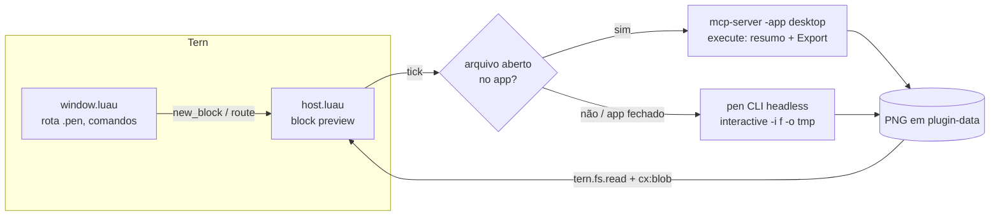

# tern-pencil-preview — Design

Data: 2026-10-13 · Status: aprovado para implementação (fase 1)

## Objetivo

Plugin do Tern que mostra designs `.pen` (pen.dev / Pencil) num block nativo:
imagem de cada frame, árvore de layers e inspetor de propriedades, atualizando
sozinho quando o design muda — inclusive quando um agente (omp, Claude) edita
pelo MCP do Pencil. A fase 2 adiciona edição leve (texto e cor) pelo próprio
block. O Pencil continua sendo o editor; o Tern é a janela de revisão.

## Fatos verificados (2026-10-13, Windows, pen CLI 0.3.9, Tern 0.8.3)

| Fato | Evidência |
| --- | --- |
| `pen --in f.pen --export out.png` exporta sem prompt/IA | 2,6 s, PNG gerado |
| `pen interactive -i f.pen -o tmp.pen` aceita comandos por stdin e sai com `exit()` | `Get`, `Export` executados, exit 0 |
| `Export(ids, "png", dir, {scale})` grava `<dir>/<nodeId>.png`; escala padrão 2 | frame 400×300 → 800×600 |
| Formatos: png, jpeg, webp, pdf, html-tailwind, html-css. **Sem SVG** | erro do `Export` com `"svg"` |
| App desktop expõe servidor MCP stdio em `<Pen>/resources/app.asar.unpacked/out/mcp-server-windows-x64.exe -app desktop` | `initialize` + `tools/list` |
| Chamada MCP avulsa (stdin com initialize, initialized, N `tools/call`; stdin fecha) termina sozinha em ~0,3 s | exit 0, respostas fora de ordem (casar por `id`) |
| `execute` e `browser` aceitam `filePath`, mas só para arquivo **já aberto** no app | erro `A file needs to be open in the editor` |
| `get_app_state` devolve markdown com ``Currently active canvas editor: `/C:/…/f.pen` `` | saída real |
| Edição via MCP fica só na memória do app; **não chega ao disco** (10 s observados) | `Update` + leitura do arquivo |
| Export pelo app reflete o estado não salvo e leva ~0,25 s | PNG mudou após `Update` |
| `Pen.exe "<arquivo>"` abre o arquivo no app (associação `.pen` no registro) | `get_app_state` passou a mostrá-lo |
| No Windows `pen` é `pen.cmd`, que roda `node <npm>/node_modules/@pen.dev/cli/dist/index.mjs` | conteúdo do shim |
| `tern.process.run` executa sem shell; procura o programa no `PATH` do daemon | doc da API |
| Node `image` do Tern: PNG/JPEG/WebP/GIF até 4096 px por lado, blob via `cx:blob`; só em block/lens | doc de elementos |

## Escopo

### Fase 1 (esta entrega)

1. Block `pencil-preview.preview` que abre um `.pen` e mostra:
   - seletor de frames de topo (anterior/próximo);
   - imagem PNG do frame selecionado, ajustada ao painel, com zoom nativo do Tern;
   - painel de layers do frame (lista indentada, selecionável) e inspetor do layer selecionado;
   - dock com modo (Ao vivo / Arquivo), nome do arquivo, frame i/n, hora da última atualização e atalhos.
2. Dois modos de fonte, escolhidos automaticamente a cada ciclo:
   - **Ao vivo**: o arquivo está aberto no app Pencil → leitura e export pelo MCP do app (vê alterações não salvas).
   - **Arquivo**: app fechado ou arquivo não aberto nele → leitura do `.pen` do disco e export pelo `pen` CLI headless.
3. Atualização automática (polling) com pausa/retomada.
4. Formas de abrir: "Open with › Pencil Preview", abrir `.pen` pelo Files/paleta/`tern open` (rota com interruptor), e o comando "Pencil: preview the document open in Pencil".
5. Ações: abrir no Pencil, abrir o `.pen` como texto, copiar id do layer, recarregar.

### Fase 2 (mesmo spec, entrega seguinte)

Edição leve no modo Ao vivo: no layer selecionado, `e` edita `content` (layers `text`) e `f` edita `fill` sólido (`#RRGGBB` ou `#RRGGBBAA`), aplicados com `Update(id, {...})` pelo MCP. A mudança entra no histórico de undo do app e é salva pelo usuário no Pencil. No modo Arquivo a edição fica desabilitada (mensagem no dock), para nunca regravar o arquivo do usuário por fora do app.

### Fora de escopo

Reconstruir o canvas em componentes nativos; editar geometria/layout; criar nodes; diff visual entre versões; plataformas além de Windows validadas nesta entrega (macOS/Linux têm caminhos por convenção, marcados como não verificados no README).

## Arquitetura



Tudo roda na metade **host** (worker do daemon, orçamento de 2 s por chamada); processos sempre via `tern.process.run` com callback, nunca bloqueando. A metade **window** só roteia aberturas e registra comandos.

### Arquivos

| Arquivo | Responsabilidade |
| --- | --- |
| `plugin.toml` | id `pencil-preview`, nome "Pencil Preview", ícone `pen`, block `preview` (`files = ["*.pen"]`, `palette = false`) |
| `host.luau` | `tern.block.define("preview", …)`: estado, ciclo de polling, teclas, eventos, save/restore |
| `window.luau` | `tern.route.open` para `.pen`, comando de interruptor da rota, comando "preview do documento aberto no Pencil" |
| `lib/launch.luau` | Resolve argv do pen CLI, caminho do servidor MCP e do app por SO, com overrides por variável de ambiente |
| `lib/mcp.luau` | Monta o stdin JSON-RPC de uma chamada avulsa, separa respostas por `id`, classifica erros |
| `lib/doc.luau` | `.pen` JSON / resumo do app → frames e layers; escala de export; leitura do cabeçalho PNG |
| `lib/script.luau` | Gera os snippets JS do `execute` (resumo, Export, Update) com escaping seguro de strings |
| `lib/view.luau` | Construtores de view puros (frames, imagem, layers, inspetor, dock, telas de erro) |
| `tests/` | Testes de unidade dos módulos puros com `luau` CLI e um stub de `tern` |

### Contratos entre módulos

```lua
-- lib/launch.luau
export type Launch = { argv: { string }, label: string }
launch.pen_cli(): Launch?            -- argv base do pen CLI (Windows: node + index.mjs; outros: "pen")
launch.mcp_server(): Launch?         -- argv base do servidor MCP, já com "-app", "desktop", "-agent", "tern-pencil-preview"
launch.pen_app(path: string): Launch?  -- argv para abrir o arquivo no app

-- lib/mcp.luau
export type Call = { tool: string, args: { [string]: any } }
export type Reply = { ok: boolean, text: string, kind: ("ok" | "not_open" | "no_app" | "tool_error" | "protocol") }
mcp.request(calls: { Call }): string                 -- stdin completo (linhas JSON)
mcp.parse(stdout: string, stderr: string, status: number, n: number): { Reply }  -- uma Reply por call, na ordem das calls
mcp.active_document(app_state_text: string): string? -- caminho nativo do documento ativo

-- lib/doc.luau
export type Layer = { id: string, name: string, type: string, depth: number, parent: string?, props: { [string]: any } }
export type Frame = { id: string, name: string, w: number?, h: number?, layers: { Layer } }
doc.from_pen(json_text: string): ({ Frame }?, string?)      -- arquivo .pen
doc.from_summary(json_text: string): ({ Frame }?, string?)  -- saída do snippet de resumo do app
doc.export_scale(f: Frame): number                          -- min(2, 4096/maior lado), piso 0.1; 1 se tamanho desconhecido
doc.png_size(bytes: string): (number?, number?)             -- IHDR

-- lib/script.luau
script.summary(max_depth: number): string            -- JS que imprime JSON {frames:[…]} com layers até max_depth
script.export(ids: { string }, dir: string, scale: number): string
script.update(id: string, props: { [string]: any }): string   -- fase 2
script.js_string(s: string): string                  -- literal JS seguro (via tern.json.encode)
```

### Estado do block

```lua
type State = {
  cx: BlockCx, path: string, name: string,
  mode: "live" | "file" | "none",       -- última fonte que respondeu
  frames: { Frame }, frame: number,     -- índice do frame selecionado
  layer: string?,                       -- id do layer selecionado
  panel: boolean,                       -- painel de layers visível
  blob: string?, png: string?,          -- blob atual e bytes que o geraram (para não reenviar igual)
  busy: boolean, paused: boolean,
  disk: string?,                        -- último conteúdo lido do disco (modo arquivo)
  cache: { [string]: string },          -- modo arquivo: frameId → caminho do PNG da revisão atual
  problem: Problem?, updated_at: number?,
}
```

Persistência (`save`): `{ frame_id, layer, panel, paused }`. Reaberturas restauram a seleção quando os ids ainda existem.

### Ciclo de atualização

- Um tick por vez (`busy`); próximo tick agendado só depois do anterior terminar: 1,5 s no modo Ao vivo, 2 s no modo Arquivo. Pausado (`space`) não agenda. Toda chamada checa se o pane do block ainda existe (`tern.pane.list`) antes de agir, como no exemplo `watch` da doc.
- **Tentativa Ao vivo** (se `launch.mcp_server()` existe): uma chamada avulsa com duas `execute` com `filePath = path`: (1) `script.summary(6)`; (2) `script.export({frame_id}, dir, scale)`. Sucesso → `mode = "live"`, atualiza frames/layers, lê o PNG e só chama `cx:blob` se os bytes mudaram. `not_open` ou `no_app` → cai para o modo Arquivo no mesmo tick. `timeout_ms = 10000`.
- **Modo Arquivo**: lê o `.pen` com `tern.fs.read(path, 16 MiB)`. Se igual a `disk` e o PNG do frame atual já está em `cache`, nada a fazer. Se mudou → `doc.from_pen`, limpa `cache`. Se falta o PNG do frame atual → `pen interactive -i <path> -o <data>/scratch/<hash>.pen` com stdin `execute({ input: <script.export> })\nexit()\n`, `timeout_ms = 60000`. O arquivo do usuário nunca é escrito.
- Escala: `doc.export_scale(frame)`. Depois de ler o PNG, `doc.png_size` confere o limite de 4096 px; se exceder (frame com tamanho `fit_content`), reexporta uma vez com escala calculada a partir do tamanho real.
- Diretório de export: `<tern.plugin.data>/exports/<chave>/`, chave = hash simples do caminho (FNV-1a em Luau), recriado por export.

### Interação

| Tecla | Ação |
| --- | --- |
| `←`/`→`, `[`/`]` | Frame anterior/próximo |
| `↑`/`↓`, `k`/`j` | Move a seleção de layer (painel aberto) |
| `l` | Mostra/oculta o painel de layers |
| `r` | Atualiza agora |
| `space` | Pausa/retoma a atualização automática |
| `p` | Abre o arquivo no Pencil (`launch.pen_app`) |
| `o` | Abre o `.pen` como texto (`cx:open`, origem `link`, que a rota ignora) |
| `y` | Copia o id do layer selecionado |
| `e`, `f` | Fase 2: editar texto / cor (Ao vivo) |

Cliques: itens da lista de layers (`select`/`activate`), badges de ação (Recarregar, Abrir no Pencil). Clique na imagem abre o visualizador com zoom do Tern.

### Rota e comandos (window)

- `tern.route.open`: assume quando o interruptor (`tern.kv` `route_pen`, ausente = ligado) está ligado, `how == "default"`, sem `line`, origem `files`, `palette` ou `cli`, e o caminho termina em `.pen` (qualquer caixa). Decisão: `{ block = "pencil-preview.preview", args = { req.path } }`. `cli` está incluído para que `tern open --split right design.pen` funcione para agentes.
- Comando "Toggle Pencil Preview for .pen opens".
- Comando "Pencil: preview the document open in Pencil": chamada MCP avulsa `get_app_state` → `mcp.active_document` → `cx:new_block("pencil-preview.preview", { path })`; sem app ou sem documento → toast explicando.

### Erros

| Situação | Comportamento |
| --- | --- |
| Sem argumento de arquivo | Card explicando como abrir |
| Arquivo inexistente / ilegível / > 16 MiB | Card de erro com Recarregar |
| JSON inválido no `.pen` | Card de erro com a mensagem do decodificador |
| Sem frames de topo | Card "documento sem frames" |
| `pen` CLI não encontrado e app fechado | Card com instrução `npm i -g @pen.dev/cli` e as variáveis de override |
| `pen` não autenticado / export sem PNG (doc avisa que pode sair 0 sem gerar) | Card com stderr resumido e `pen login`; o PNG é sempre verificado com `tern.fs.exists` |
| Timeout | Card com Recarregar; o polling continua |
| Falha transitória com imagem anterior na tela | Mantém a imagem, mostra aviso no dock |

### Overrides (variáveis de ambiente do daemon)

`TERN_PENCIL_CLI` (caminho do `pen`/`pen.cmd` ou do `index.mjs`), `TERN_PENCIL_MCP` (binário do servidor MCP), `TERN_PENCIL_APP` (executável do app).

Padrões: Windows — CLI pelo `pen.cmd` no `PATH` traduzido para `node <dir>/node_modules/@pen.dev/cli/dist/index.mjs`; MCP e app em `%LOCALAPPDATA%\Programs\Pen\…`. macOS (não verificado) — `pen`; `/Applications/Pen.app/Contents/Resources/app.asar.unpacked/out/mcp-server-darwin-<arch>`; app via `open -a Pen`. Linux (não verificado) — `pen`; sem MCP padrão; `xdg-open`.

## Testes

- **Unidade** (`luau tests/run.luau`): `doc` (frames/layers de `.pen` real, `fit_content`, sem frames, JSON inválido, escala, IHDR), `mcp` (stdin gerado, respostas fora de ordem, `not_open`, erro de spawn/stdout vazio, `active_document` com caminho `/C:/…`), `script` (escaping de aspas/barras/quebras de linha no caminho e nos valores), `launch` (Windows com `pen.cmd` no PATH, override por env, nada encontrado) com stub de `tern.fs.exists`/`tern.getenv`/`tern.runtime`.
- **Tipos**: `luau-analyze` com `tern.d.luau` gerado por `tern plugin types`.
- **Smoke real** (obrigatório antes de publicar): `tern plugin link .`; `tern open` num `.pen` → o block mostra a imagem (`tern ctl tree "[data-surface='plugin.pencil-preview.preview']"`); abrir o mesmo arquivo no Pencil, aplicar `Update` pelo MCP e ver o modo mudar para Ao vivo e a imagem atualizar sem salvar; fechar o app e ver o modo Arquivo.

## Publicação

Repositório público `SamuelFontess/tern-pencil-preview` (MIT), README em inglês com instalação `tern plugin install github.com/SamuelFontess/tern-pencil-preview`, requisitos e limites. Entrada no awesome-tern pela seção **Blocks**, editando `list.yml` conforme o `CONTRIBUTING.md` deles, via PR.
